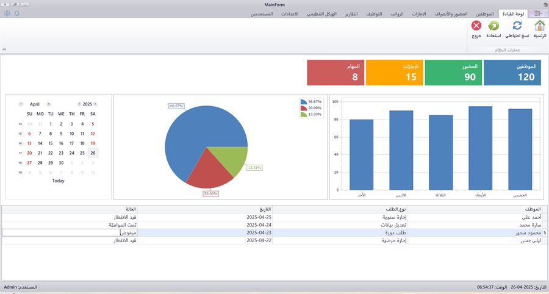
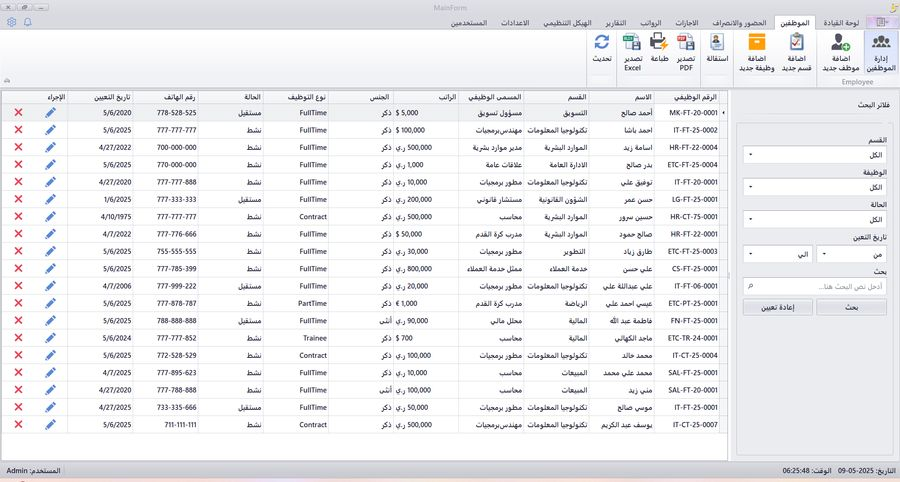
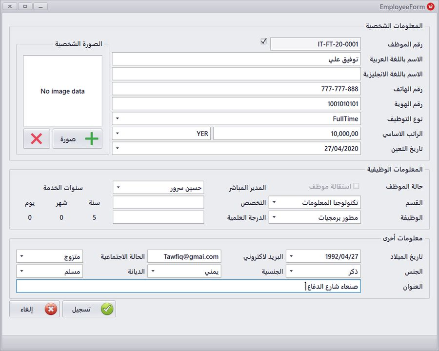
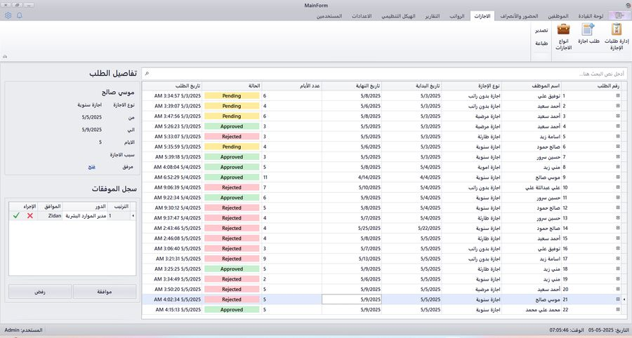
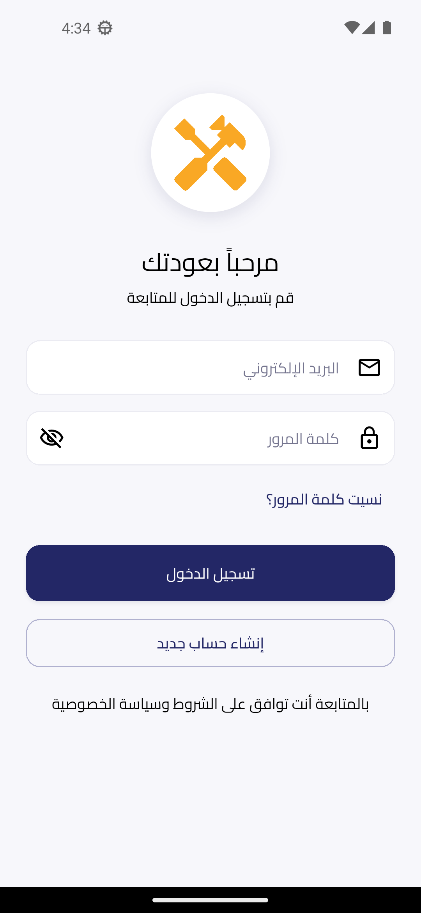
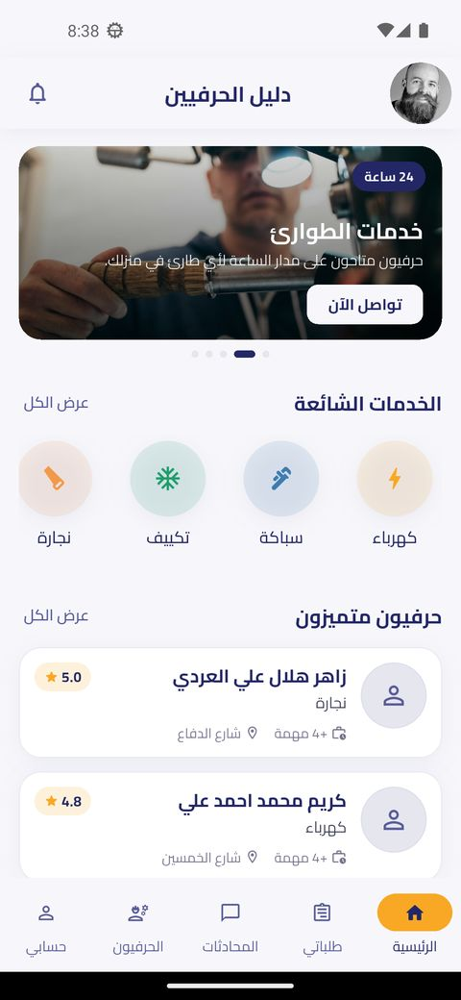

# Zidan Al-Hilali

**Junior .NET Developer** — ASP.NET Core MVC · Windows Forms · SQL Server · Flutter

Sana'a, Yemen — open to remote work · B.Sc. Information Technology, GPA 90% · 650+ programming problems solved

[Portfolio](https://zidanalhilali.netlify.app) &nbsp;·&nbsp; [Email](mailto:zidan3.dev@gmail.com) &nbsp;·&nbsp; [LinkedIn](https://linkedin.com/in/zidanalhilali)

 

## About

I build full features end to end — requirements, UI design, implementation, and version control — rather than isolated functions. My foundation is object-oriented programming, data structures, and algorithms, and I've applied it to three projects: an ASP.NET Core MVC web app, a desktop HR system, and a real-time mobile marketplace.

 

## Toolset

<table>
<tr><td width="180"><strong>Web / Backend</strong></td><td>C#, .NET, ASP.NET Core MVC, Razor, Entity Framework Core (Code-First, Migrations), LINQ, SQL Server</td></tr>
<tr><td><strong>Desktop</strong></td><td>.NET Windows Forms</td></tr>
<tr><td><strong>Mobile</strong></td><td>Flutter, Dart, Riverpod, Firebase Authentication, Cloud Firestore</td></tr>
<tr><td><strong>Practices</strong></td><td>OOP, Clean Code, MVC, Repository pattern, Dependency Injection, Clean Architecture</td></tr>
<tr><td><strong>Foundations</strong></td><td>Data Structures &amp; Algorithms, SQL, Git / GitHub</td></tr>
</table>

 

## Projects

**Bookstore — ASP.NET Core MVC Web Application** &nbsp;·&nbsp; *Independent project* &nbsp;·&nbsp; [Source code](https://github.com/zidanalhilali/Bookstore)
 Book catalog web app with full CRUD for books and authors, image upload, search, and validation

- Built with ASP.NET Core MVC and Entity Framework Core (Code-First, Migrations) on SQL Server, with a one-to-many relationship between authors and books.
- Repository pattern, Dependency Injection, and ViewModels; server-side and client-side validation, anti-forgery protection, and image upload with file validation.
- Search with LINQ translated to SQL, safe delete rules (Restrict) to protect data integrity, and proper 404 and error handling.

 

**HRPro — Employee Management System (Windows Forms)** &nbsp;·&nbsp; *Independent project*
 Desktop HR system covering employee records, attendance and leave tracking, role-based login, and exportable reports

- Three-layer architecture (UI, domain, data access).
- Data layer modeled with EF Core (Code-First) and migrations against SQL Server, using LINQ, Dependency Injection, and the Repository pattern.

*Academic submission — source is private. Screenshots below are from the running app.*

<table>
<tr>
<td align="center" width="260"> Dashboard — attendance &amp; leave overview</td>
<td align="center" width="260"> Employee records</td>
</tr>
<tr>
<td align="center" width="260"> Add employee</td>
<td align="center" width="260"> Leave requests</td>
</tr>
</table>

 

## Experience

**Mobile App Development Intern** — Pixel Mind &nbsp;·&nbsp; *Jun 2026 – Aug 2026*
 Craftsmen Directory — a two-sided MVP marketplace connecting customers with local service providers

- Built a two-sided MVP marketplace covering registration, profiles, service requests, and reviews.
- Implemented authentication, search &amp; filtering, and a ratings system with Flutter, Firebase Authentication, and Cloud Firestore.
- Designed the full UI and design system in Google Stitch, then implemented every screen in Flutter.
- Structured the app with Feature-First and Clean Architecture principles, using Riverpod for state management.
- Worked in a two-person team on Git/GitHub with feature branches and pull requests.

*Client project — source is private. Screenshots below are from the live build.*

<table>
<tr>
<td align="center" width="150"> Login</td>
<td align="center" width="150"> Customer home</td>
<td align="center" width="150"> Browse craftsmen</td>
<td align="center" width="150"> Craftsman home</td>
<td align="center" width="150"> Ratings</td>
</tr>
</table>

 

## Currently learning

Following a structured programming roadmap and deepening **ASP.NET Core** — next on my list: Web APIs, JWT authentication, and unit testing with xUnit.

 

## Contact

<table>
<tr><td width="90">Email</td><td>zidan3.dev@gmail.com</td></tr>
<tr><td>Portfolio</td><td><a href="https://zidanalhilali.netlify.app">zidanalhilali.netlify.app</a></td></tr>
<tr><td>LinkedIn</td><td><a href="https://linkedin.com/in/zidanalhilali">linkedin.com/in/zidanalhilali</a></td></tr>
</table>
